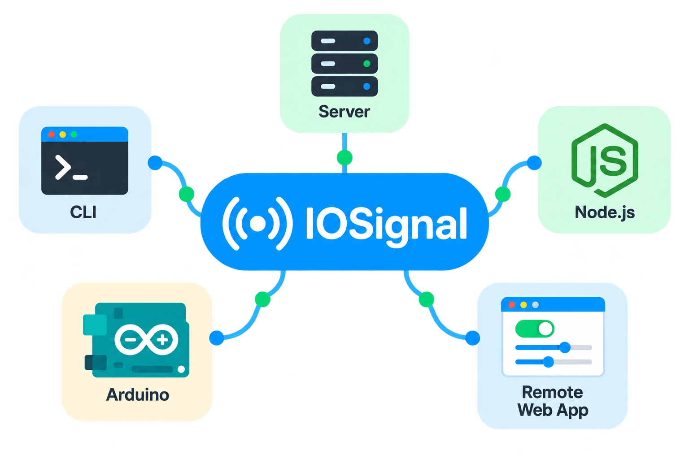

# IOSignal 실습실

IOSignal과 Remocon 아두이노 예제를 예제별 페이지로 안내하고, 브라우저에서 시그널을 직접 주고받는 웹 실습실을 함께 제공하는 오픈소스 사이트입니다. HTML/CSS/JavaScript로 만들며, 계정 관리 서비스 없이 사용할 수 있습니다. 라이선스는 MIT입니다.

<p align="center">
  
</p>

## 페이지

| 주소 | 내용 |
| --- | --- |
| `/` | 예제 목록. IOSignal 예제와 Remocon 예제를 나눠 보여 줍니다. |
| `/examples/<라이브러리>/<예제>/` | 예제 페이지. 사진·회로도, 준비물, 배선·핀맵, 사용 순서, 시그널 흐름, 참고, 소스 코드 링크 |
| `/lab/` | 웹 실습실. 서버에 연결해 임의 태그를 보내고 구독하며 로그를 봅니다. |
| `/webrtc/` | IOSignal을 시그널링에 쓰는 1:1 화상채팅 예제 ([webrtc/](webrtc/README.md)) |

모든 페이지는 같은 상단 메뉴를 씁니다. 예전 주소 `/?preset=…`는 `/lab/`으로 이동합니다.

## 실행

Node.js 22.12 이상이 필요합니다.

```sh
npm ci
npm start
```

`http://localhost:8080`을 엽니다. 실행할 때 예제 페이지를 먼저 만듭니다.

- `npm start`: 웹 화면만 실행합니다. 웹 실습실에서 서버 URL을 입력해 기존 IOSignal 서버에 연결합니다.
- `npm run dev`: 로컬 웹 화면과 IOSignal 중계 서버를 함께 실행합니다.
- `npm run generate`: 예제 페이지만 다시 만듭니다.
- `npm run build`: 예제 페이지를 만들고 Vite로 번들링합니다. `dist/`가 정적 배포 결과입니다.

| 용도 | 로컬 기본값 |
| --- | --- |
| 웹 화면 | `http://localhost:8080` |
| WebSocket | `ws://localhost:7777` |
| Arduino TCP | PC의 LAN IP, 포트 `55488` |

`PORT`, `WS_PORT`, `TCP_PORT` 환경변수로 포트를 바꿀 수 있습니다. Arduino의 호스트에는 `localhost`가 아닌 PC의 LAN IP를 넣습니다. 웹 서버는 로컬 PC에서만 열리며, Arduino는 별도의 TCP 중계 포트에 연결합니다.

공개 서버를 쓸 때는 웹과 보드를 같은 서버에 맞추세요. IOSignal 예제는 `io.iosignal.net` / `wss://io.iosignal.net/ws`, Remocon 예제는 `io.remocon.kr` / `wss://io.remocon.kr/ws`를 기본으로 씁니다.

## 예제 페이지의 내용

예제 문서는 이 저장소에서 직접 쓰지 않습니다. 아두이노 예제의 원본 저장소가 예제마다 `_doc/example.json`과 사진·회로도를 관리하고, 공개 저장소([iosignal-arduino](https://github.com/remocons/iosignal-arduino), [remocon-arduino](https://github.com/remocons/remocon-arduino))에 올라간 예제만 이 저장소로 내보냅니다.

| 위치 | 내용 |
| --- | --- |
| `content/examples/<라이브러리>/<예제>.json` | 내보낸 예제 문서 |
| `static/media/<라이브러리>/<예제>/` | 내보낸 사진·회로도·핀맵 이미지. 사이트의 `/media/…`로 그대로 배포됩니다. |
| `scripts/site/` | 페이지 틀과 웹 실습실 본문 |
| `scripts/generate.mjs` | `public/` 아래에 `index.html`, `lab/index.html`, `examples/**/index.html`을 만듭니다. 이 파일들은 빌드 결과라 git에 넣지 않습니다. |

`content/`와 `static/media/`는 손으로 고치지 말고 원본 저장소에서 다시 내보내세요. 페이지 모양은 `scripts/site/pages.mjs`와 `public/style.css`에서 바꿉니다.

예제 페이지의 상태 배지는 다음 뜻입니다.

- **초안 · 실물 미확인**: 코드를 보고 쓴 설명이며 실제 보드로 확인하지 않았습니다.
- **실물 확인 예제**: 실제 보드로 확인한 기록이 있습니다.

## 웹 실습실

- 서버 URL 입력, ready·CID 확인, 선택적 ID_KEY 인증
- 임의 태그 송신, 구독 목록 적용·전체 해제, 재접속 시 재구독
- EMPTY, TEXT, BINARY HEX, JSON 객체·배열·null, 여러 인자 입력
- 최근 200건 TX/RX 로그, 타입·바이트 표시, 필터·복사·표시 일시정지

TX는 송신 호출이며 실행 완료 확인이 아닙니다. 같은 태그를 구독하면 자신의 메시지가 RX로 들어올 수 있습니다. 장치의 적용 결과는 장치가 보내는 상태로 확인하세요. 인증키는 연결할 때만 쓰고 입력창을 비우며, 저장소·로그·템플릿에 저장하지 않습니다. 인증키 발급이나 계정 관리 기능은 제공하지 않습니다.

### 템플릿

템플릿은 장치 검색·제어 규칙(key=value 정보와 상태, `#search`/`#notify`, `<cid>@` 명령, 그룹 채널의 `#채널$state`)을 따릅니다.

| 템플릿 | 태그 | 대상 |
| --- | --- | --- |
| 채널 송수신 (`basic`) | `#homeButton`, TEXT | IOSignal 채널 예제 (`esp8266_channel_txrx` 등) |
| 장치 제어 (`cid`) | `#search` → `<cid>@` 명령 → `<cid>@$info`, `<cid>@$state` | Remocon 장치 예제 |
| 그룹 공유 상태 (`group`) | `#switch$state`, `s1=1;s2=0;s3=0` | Remocon 그룹 예제 (`wifi-simple`, `esp32-group-led` 등) |
| 모터 PWM 4바이트 (`motor`) | `#robot`, M1A/M1B/M2A/M2B 4바이트 | 규약에 맞는 별도 장치 |
| 방향 문자열 (`direction`) | `#robot`, u/l/s/r/d TEXT | 규약에 맞는 별도 장치 |

모터·방향은 규약에 맞는 별도 장치용 도구이며 이 저장소에서 실물 로봇 검증을 제공하지 않습니다. 모터 장치에는 통신 타임아웃 정지를 구현하세요.

주소로 템플릿과 값을 미리 채울 수 있습니다. 예제 페이지의 "웹 실습실에서 열기"가 이 방식을 씁니다. 연결과 송신은 사용자가 직접 실행합니다.

```
/lab/?preset=group&tag=%23lab%24state&sub=%23lab%24state
```

| 매개변수 | 뜻 |
| --- | --- |
| `preset` | `basic`, `cid`, `group`, `motor`, `direction` |
| `tag` | 송신 태그 |
| `value`, `type` | 보낼 값과 형식(`text`, `empty`, `hex`, `json`, `args`) |
| `sub` | 구독 태그, 쉼표로 구분 |

## 보드 없이 CID 흐름 체험

`npm run dev`로 로컬 서버를 실행한 상태에서 다른 터미널에 `npm run demo:device`를 실행합니다. 웹 실습실에서 `ws://localhost:7777`에 연결하고 장치 제어 템플릿의 장치 찾기를 누르면 `Simulated LED`를 제어할 수 있습니다. 콘솔과 상태 메시지만 바뀌는 모의 장치이며 실제 GPIO 동작은 아닙니다.

## 개발과 검증

```sh
npm test
npx playwright install chromium
npm run test:ui
```

이미 설치된 Chrome을 쓰려면 `CHROME_PATH`에 실행 파일 경로를 지정합니다. `npm test`는 페이지 생성과 입력 규칙을 검사하고, 공개 IOSignal 서버를 로컬에서 띄워 검색·CID·보관 상태·payload를 확인합니다. UI 검사는 별도 로컬 포트 18080/17777/55489를 쓰며 홈 → 예제 페이지 → 웹 실습실 흐름과 실습실 송수신, 모바일 화면을 확인합니다. 서버·장치는 모의 클라이언트이며 실제 Arduino 검증을 대신하지 않습니다.

소스 구조:

- `scripts/site/pages.mjs`: 공통 메뉴, 홈 목록, 예제 페이지 틀
- `scripts/site/lab-body.html`: 웹 실습실 본문
- `scripts/generate.mjs`: 페이지 생성
- `public/lab/lab.js`: 웹 실습실의 연결·구독·제어·로그 UI
- `public/lib/protocol.js`: 템플릿과 입력·표시 규칙, 주소 매개변수
- `public/style.css`: 모든 페이지의 스타일
- `scripts/serve.mjs`: 페이지 생성 후 Vite 개발 서버와 선택적 IOSignal 중계 서버 실행
- `tests/`: 페이지 생성·입력·실제 로컬 통신·브라우저 검사
- `vite.config.js`: 다중 페이지 빌드 설정. `static/`의 파일은 그대로 복사합니다.

배포는 자동 실행하지 않습니다. `npm run build` 이후 `dist/`를 원하는 정적 호스팅에 배포하세요. `./upload.sh`는 빌드 후 기존 서버 `ia:/home/ubuntu/sites/test_iosignal_net/`로 전송합니다. 다른 대상은 `DEPLOY_TARGET` 환경변수로 지정합니다. `/webrtc/`는 `webrtc/`에서 따로 빌드해 배포합니다.

## 패키지

브라우저 코드는 `import IO from 'iosignal/io'`로 설치한 npm 패키지의 브라우저 ESM을 사용합니다. vendor 파일 복사는 필요하지 않습니다. `package-lock.json`으로 재현 가능한 설치를 유지하며 `npm install iosignal@latest`로 의도적으로 업데이트할 수 있습니다. 웹 실습실 상단 버전은 실행 중인 `IO.version`에서 읽습니다.

## HTTP / HTTPS와 WebSocket 선택

- [HTTPS 웹 실습실](https://test.iosignal.net/lab/): 공개 WSS 서버 접속의 기본 주소입니다.
- [HTTP 웹 실습실](http://test.iosignal.net/lab/): WS 실습용 대안입니다. HTTP로 바꿔도 브라우저의 로컬 네트워크 접근 제한이 모두 해결되지는 않습니다.

상단에 현재 HTTP/HTTPS 접속 방식이 표시됩니다. 전환 버튼은 제공하지 않습니다. HTTPS에서 WS 연결이 차단되면 브라우저 주소창에 `http://test.iosignal.net`을 직접 입력하여 새로 접속하세요. 기본 `npm start`는 HTTP만 제공합니다.

| 웹앱 페이지 | WebSocket 서버 | 안내 |
| --- | --- | --- |
| HTTPS | 공개 `wss://…` | 권장 구성 |
| HTTPS | `ws://…` | 앱은 연결을 시도하지만 브라우저가 혼합 콘텐츠로 차단할 수 있음 |
| HTTPS | `ws://localhost:7777` 또는 LAN의 `ws://192.168.x.x:7777` | 브라우저·버전·로컬 네트워크 접근 권한에 따라 허용 여부가 달라짐 |
| `http://localhost:8080` | `ws://localhost:7777` | 같은 PC에서의 로컬 실습 |
| 공개 HTTP 웹앱 | LAN·localhost 서버 | 로컬 접근에 보안 컨텍스트를 요구하는 브라우저에서는 제한될 수 있음 |

HTTPS에서 WS 주소를 입력하면 HTTP 주소를 직접 입력하여 새로 접속하라는 안내를 표시합니다. 앱에서 WS 연결을 일괄 차단하지 않습니다. WSS를 사용하려면 서버에도 TLS와 브라우저가 신뢰하는 인증서가 준비되어 있어야 합니다. 주소의 `ws`만 `wss`로 바꾸는 것으로 서버 설정이 변경되지는 않습니다.

`localhost`는 브라우저가 실행 중인 기기 자신입니다. 다른 PC의 서버에는 그 PC의 LAN IP를 입력합니다. 현재 로컬 웹앱 개발 서버는 `127.0.0.1:8080`에만 바인딩되어 다른 LAN 기기에서 화면에 접속할 수 없습니다. LAN에 웹앱을 제공하려면 서버의 수신 주소 및 방화벽 설정을 별도로 구성해야 합니다. 웹 화면 접속 포트와 IOSignal WebSocket/TCP 포트는 서로 다릅니다.

연결 실패 시 서버 주소·서버 실행 여부·TLS·방화벽을 확인하고, 브라우저가 로컬 네트워크 접근 권한을 요청하는 환경에서는 해당 권한도 확인하세요. 브라우저별 예외를 모든 환경에서의 연결 보장으로 해석하지 않습니다. [로컬 네트워크 접근 설명](https://developer.mozilla.org/en-US/docs/Web/Security/Defenses/Local_network_access)

### HTTP 주소를 입력해도 HTTPS로 열리는 경우

브라우저의 HTTPS 자동 전환 또는 HSTS 정책, 서버 리다이렉트로 인해 HTTP 이동 요청이 HTTPS로 바뀔 수 있습니다. 주소창에 HTTP 주소를 직접 입력해도 HTTPS로 열리면 WSS 서버 또는 로컬에서 실행한 웹앱을 사용하세요.
